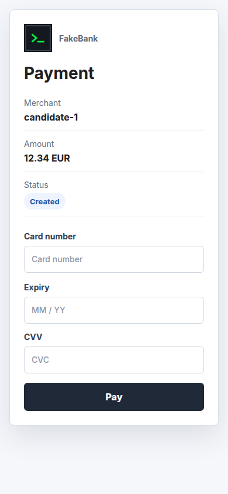
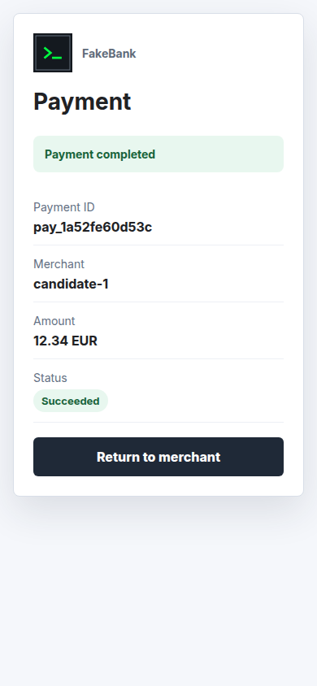

<p></p>

# FakeBank

**An open-source card payment provider simulator for integration testing.**

FakeBank lets developers test payment flows locally without connecting to a real
acquiring service. It combines a Payment API, a checkout interface, predefined
payment scenarios, and webhook notifications in a controlled environment.

## Features

- **Payment API** — Create payments, retrieve their status, and confirm test transactions.
- **Checkout** — Complete simulated card payments through a browser interface.
- **Payment scenarios** — Exercise successful, declined, delayed, timed-out,
  duplicate-notification, and provider-error flows.
- **Webhooks** — Receive payment outcome notifications; delivery attempts are stored in PostgreSQL.
- **PostgreSQL** — Persist payment records and related state.
- **Docker Compose** — Run the API, Checkout, and PostgreSQL together.
- **Example Merchant** — Explore a reference integration with the API and webhooks.

## Checkout Preview

Payment form and completed test payment in the local Checkout interface (mobile viewport).

<p>
  
  
</p>

## Quick Start — Docker

**Published images:** The 0.2.0 API and Checkout images are public on GHCR and
verified for Linux amd64, including anonymous pulls and an external-host payment
flow. FakeBank v0.2.0 was officially released on November 18, 2026. See the
[GitHub Release v0.2.0](https://github.com/nick-roust/fake-bank/releases/tag/v0.2.0).

Follow [published-image installation](docs/DISTRIBUTION.md#install-published-images)
to obtain the Compose files and create `.env.release` with the verified digests.
Then run from the directory containing `docker/`:

```sh
docker compose --env-file .env.release -f docker/docker-compose.release.yml -f docker/docker-compose.release.lock.yml pull
docker compose --env-file .env.release -f docker/docker-compose.release.yml -f docker/docker-compose.release.lock.yml up -d --no-build
```

Requires Docker Engine with Compose v2, registry network access, a browser and free
loopback ports 8080/5173. No host Node.js, pnpm or application source checkout is
required. PostgreSQL, migrations, API and Checkout start together; PostgreSQL has
no host port. The first-payment walkthrough requires an external webhook receiver.

**Source-build development:** From a source checkout, build development `:local`
images with the separate development Compose file:

```sh
docker compose -f docker/docker-compose.yml up --build -d --wait
```

This alternative requires build-time network access and free ports 8080, 5173 and
55432. It builds locally instead of installing the published images; no host
Node.js/pnpm is needed for the Docker build. Run one of these configurations at a
time. Example Merchant remains a separate native example, not a Compose service.

## First Test Payment

Use an existing JSON webhook receiver reachable from the API container. Its address
is different from the browser return address; container localhost is not host
localhost. See the [full setup and first-payment walkthrough](docs/DISTRIBUTION.md#payment-walkthrough)
for webhook receiver requirements, URL configuration, payment creation, Checkout
confirmation, result readback, and webhook verification. It requires an existing
receiver; no receiver service is bundled with FakeBank.

Create a `card_success` payment, open the exact returned `checkout_url`, and enter
card `4242424242424242`, expiry `12/30`, CVV `123`. After Pay, expect Succeeded,
a `succeeded` payment readback, and a matching `payment.succeeded` event at your
receiver. For decline, select `card_declined` with `4000000000000002`.

Use test inputs only. FakeBank does not move real funds or connect to banking rails.

## Documentation

- [Development](docs/DEVELOPMENT.md) — Native setup, workspace tools and validation.
- [API Reference — OpenAPI](openapi/openapi.yaml) — The single API contract.
- [Integration](docs/INTEGRATION.md) — Example Merchant, Docker addressing and webhooks.
- [Scenarios](docs/SCENARIOS.md) — Six predefined outcomes and timing behavior.
- [Domain](docs/DOMAIN.md) — Payment lifecycle and test-card semantics.
- [Persistence](docs/PERSISTENCE.md) — PostgreSQL schema and migrations.
- [Architecture](docs/ARCHITECTURE.md) — Product boundaries and component ownership.
- [Distribution](docs/DISTRIBUTION.md) — Image-only configuration and lifecycle.
- [0.2.0 release notes](docs/RELEASE_NOTES_v0.2.0.md) — Release scope and completed technical verification.
- [Changelog](CHANGELOG.md) — Version history.

## Validation

With Node.js 24 and pnpm 11.0.9 installed:

```sh
pnpm install --frozen-lockfile
pnpm validate
```

Validation covers contract/migration checks, typechecks, API tests, the stub-based
merchant smoke test, and Checkout build. Placeholder workspace test scripts do not
provide browser or PostgreSQL integration coverage.

## Limitations

Callbacks are unsigned and have no durable retry worker. Payment creation has no
Idempotency-Key replay contract. Delayed timers are process-local and are not
restored after restart; Checkout does not automatically poll delayed results.
This distribution targets one local instance. Hosted Demo, multi-instance support,
production payment security, real acquiring and settlement are outside its scope.

## Author & License

FakeBank was created and is maintained by Nick Roust.

Copyright © 2026 Nick Roust.

Licensed under the Apache License, Version 2.0. See [LICENSE](LICENSE).

Third-party components are distributed under their respective licenses. See
[Third-Party Notices](THIRD_PARTY_NOTICES.md) for applicable copyright and license
information.
